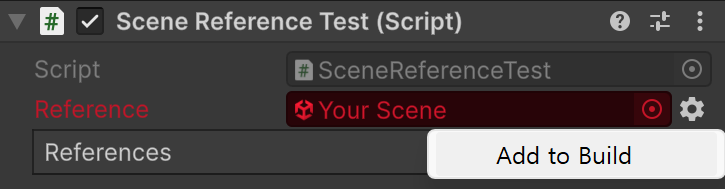

# 🧅 Onion.SceneManagement

Async scene loading, stable scene references, and transition flows for Unity.

Scenes are referenced by GUID, so renaming or moving a scene never breaks a reference. Loading and unloading go through **transitions**: one awaitable flow that notifies the scenes, unloads, loads, and runs your own steps in between.

## Why

Unity's scene API leaves a lot to every project:

- Scenes are referenced by **name, path or build index**, which break silently when a scene is renamed, moved, or reordered.
- `LoadSceneAsync` / `UnloadSceneAsync` are single operations. Fading out, unloading the old scenes, loading the new ones, and telling objects about it is up to you, every time.
- Scenes have no enter / exit callbacks, and a game that needs managers loaded first has to make sure it always starts from that scene, also in the Editor.

## Getting started

### Installation

Install via Unity Package Manager (UPM).

`https://github.com/onion-unity/onion-scene-management.git`

Requires Unity 6000.0 or later. Addressables (`com.unity.addressables`) is optional; when it is installed, Addressable scenes are supported too.

### Setup

Nothing to add to your scenes. On first load, the package creates `Assets/Settings/Onion_SceneManagementSetting`, the project-wide settings, and registers it for the Editor and builds.

```csharp
using Onion.SceneManagement;

[SerializeField] SceneReference _title;

await SceneManager.LoadSceneAsync(_title);
```

## SceneReference

A `SceneReference` field shows as a scene asset field in the inspector and is stored as the scene's GUID.



- A scene that isn't in the Build Profile scene list is shown in red; the button next to the field adds it.
- In code, create one with `SceneReference.FromPath`, `FromName`, `FromBuildIndex`, `FromScene`, or `FromAddress` (Addressables).
- `path`, `name`, `buildIndex`, `scene` and `isLoaded` resolve the reference at runtime.
- **Scene Group** assets (**Assets > Create > Scene > Scene Group Asset**) hold a list of scenes to load or unload together.

## Loading and Unloading

`SceneManager.LoadScene(s)Async` takes a `SceneReference`, a scene name, or a build index. Addressable scenes go through `SceneReference.FromAddress`. Each method also has a non-awaitable version (`LoadScene`, `LoadScenes`, ...), and `IEnumerable<SceneReference>` gets `LoadAsync()` / `UnloadAsync()` extensions.

The given scenes are the **destinations**: the scenes that should be loaded when the transition ends. A `TransitionMode` decides how to get there:

| Load mode | Behavior |
| --- | --- |
| `None` | Loads a destination only if it isn't loaded yet. |
| `Additive` | Always loads another instance of each destination. |
| `Refresh` | Unloads a loaded destination first, then loads it again. |

| Unload mode | Behavior |
| --- | --- |
| `CleanUp` | Unloads every loaded scene that isn't a destination, except [pinned](#pinning) scenes and the [Bootstrap](#bootstrap) scene. |
| `None` | Keeps every loaded scene. |

`TransitionMode.Default` is `None` + `CleanUp`. `TransitionMode.Additive` and `TransitionMode.Refresh` also use `CleanUp`.

```csharp
await SceneManager.LoadSceneAsync(_level);                           // only _level stays loaded
await SceneManager.LoadSceneAsync(_hud, new TransitionMode(LoadMode.None, UnloadMode.None));  // add _hud
await SceneManager.UnloadSceneAsync(_hud);                           // unload _hud only
```

`UnloadScene(s)Async` unloads exactly the given scenes, pinned ones included. The Bootstrap scene is never unloaded.

By default the old scenes are unloaded before the new ones load. Check **Overlapped Load** in the settings to load first, so the old scenes stay until the new ones are ready (both are in memory for a moment).

### Pinning

Pinned scenes are never unloaded by `CleanUp`, such as a HUD or an audio scene that stays across levels. Unloading one by name still works and unpins it.

```csharp
SceneManager.Pin(_hud);      // or _hud.Pin()
SceneManager.Unpin(_hud);
```

## Transitions

`SceneManager.LoadSceneAsync` is a shortcut for this flow:

```csharp
using Onion.SceneManagement.Transition;

await Transition.Create(_level)
    .NotifyExit()
    .Unload()
    .Load()
    .NotifyEnter()
    .ExecuteAsync();
```

Build your own with any of these steps:

| Step | Description |
| --- | --- |
| `Load` / `Unload` | Loads the destinations / unloads the scenes the `TransitionMode` removes. All scenes load (or unload) in parallel. |
| `NotifyExit` / `NotifyEnter` | Calls the [scene handlers](#scene-handlers) of the scenes being unloaded / loaded. |
| `Callback` | Runs your code. A `Func<Awaitable>` overload is awaited, e.g. a fade. |
| `Delay` / `DelayFrame` / `NextFrame` | Waits for seconds (optionally ignoring time scale) or frames. |
| `WaitWhile` / `WaitUntil` | Waits for a condition, like Unity's `WaitWhile` / `WaitUntil`. |
| `WaitForEndOfFrame` / `WaitForFixedUpdate` | Waits for that point of the frame. |

```csharp
await Transition.Create(_level)
    .Callback(FadeOutAsync)
    .NotifyExit()
    .Unload()
    .Load()
    .NotifyEnter()
    .Delay(0.5f)
    .Callback(FadeInAsync)
    .ExecuteAsync();
```

- `Callback`, `Delay`, `DelayFrame`, `WaitWhile` and `WaitUntil` take `parallel: true` to run alongside the following steps; the next step without it waits for them.
- A transition runs once. Create a new one each time.

## Scene Handlers

`MonoBehaviour`s in a scene that implement these interfaces are called when their scene enters or exits a transition:

| Interface | Called |
| --- | --- |
| `ISceneEnterHandler` / `IAsyncSceneEnterHandler` | By `NotifyEnter`, after the scene is loaded. |
| `ISceneExitHandler` / `IAsyncSceneExitHandler` | By `NotifyExit`, before the scene is unloaded. |

```csharp
using Onion.SceneManagement.Handler;

public class TitleScreen : MonoBehaviour, ISceneEnterHandler, IAsyncSceneExitHandler {
    public void OnSceneEnter() { }

    public async Awaitable OnSceneExitAsync() {
        await FadeOutAsync();
    }
}
```

- Async handlers are awaited before the transition goes on. Async exit handlers run before the others; enter handlers run before the async ones.
- Mark the handler method with `[ExecuteByAnyScene]` (`Onion.SceneManagement.Handler.Attributes`) to call it on every transition, not only when its own scene enters or exits.
- `SceneManager.sceneLoaded` / `sceneUnloaded` are raised for every scene loaded or unloaded through the package.

## Bootstrap

A Bootstrap scene holds what lives for the whole game, such as managers and services, and is always loaded first. In the settings asset, check **Use Bootstrap** and assign the **Bootstrap Scene**, or click **Create** to make one.

| Setting | Description |
| --- | --- |
| **Bootstrap Scene** | Loaded first and never unloaded. Gets no exit notifications. |
| **Initial Scenes** | Loaded after the Bootstrap scene when a build starts. |

- **In a build**, the Bootstrap scene must be the first scene. The build fails otherwise, and the settings inspector shows a warning with a **Fix** button that moves it to the top of the Build Profile scene list.
- **In the Editor**, entering Play Mode always starts from the Bootstrap scene, whichever scene is open, then opens the scenes that were open again.
- **Placeholder** (Add Component > Onion > SceneManagement > Placeholder): for objects a scene only needs when played on its own, such as a camera or an EventSystem that the Bootstrap scene already provides. They are destroyed while the Bootstrap scene is running, and removed from builds.

## Settings

The settings asset (`Assets/Settings/Onion_SceneManagementSetting`) is edited in its own inspector. There is no Project Settings page yet.

| Setting | Description |
| --- | --- |
| **Overlapped Load** | Load the new scenes before unloading the old ones. |
| **Use Bootstrap** | See [Bootstrap](#bootstrap). |

- The asset is registered in `EditorBuildSettings`, and added to Preloaded Assets only while a player build runs, so Project Settings don't change. Nothing is created in batch mode.
- `SceneManagementSettings.useBootstrap` and `overlapLoading` can be changed from scripts. They are reloaded from the asset at the start of every Play session, also with domain reload disabled.

## Credits

`SceneReference` is based on the ideas from [Eflatun.SceneReference](https://github.com/starikcetin/Eflatun.SceneReference) by starikcetin.

## Changelog

See [CHANGELOG.md](CHANGELOG.md), including migration notes.

## License

MIT. See [LICENSE](LICENSE).
